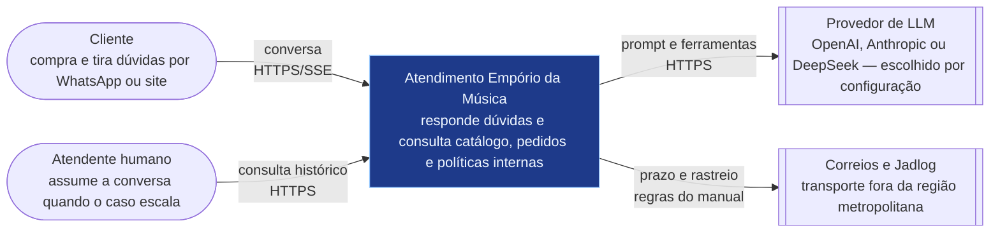
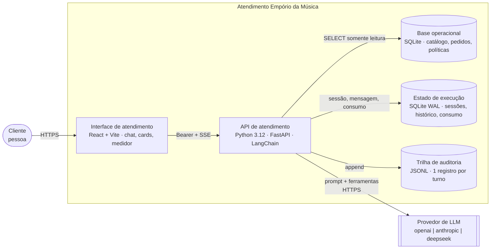
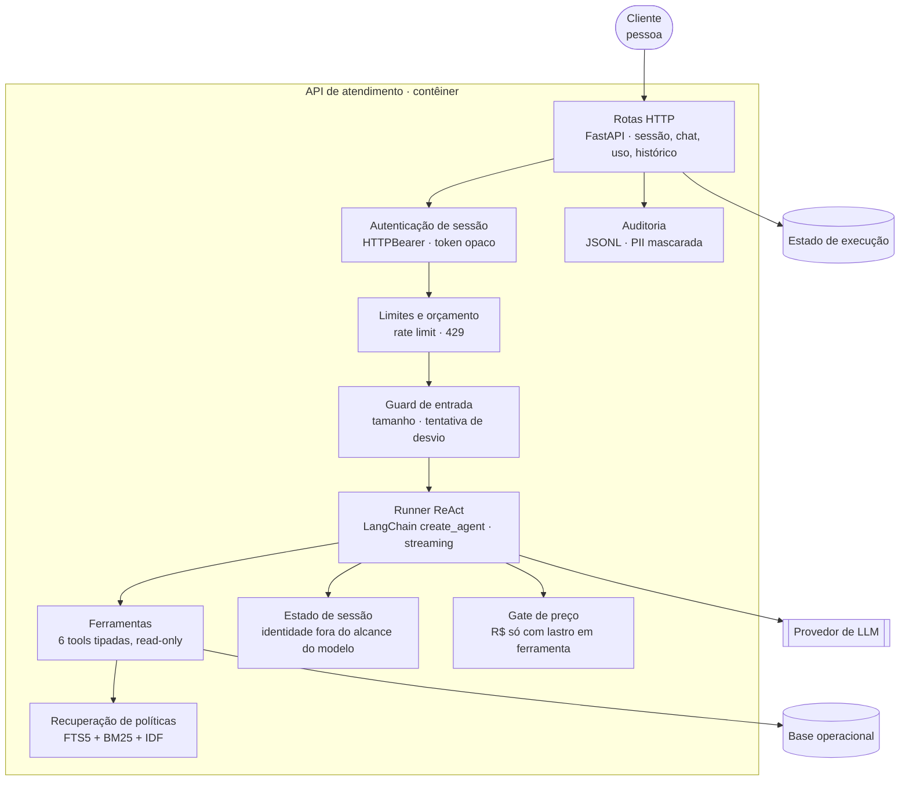
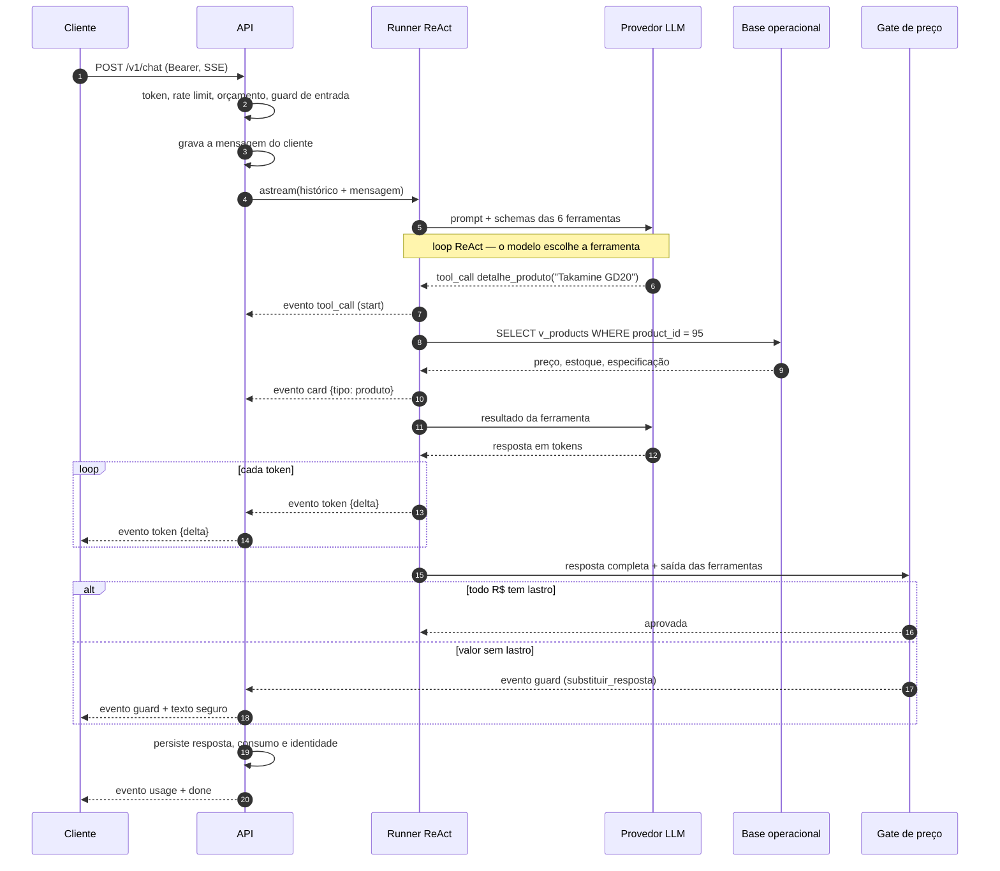
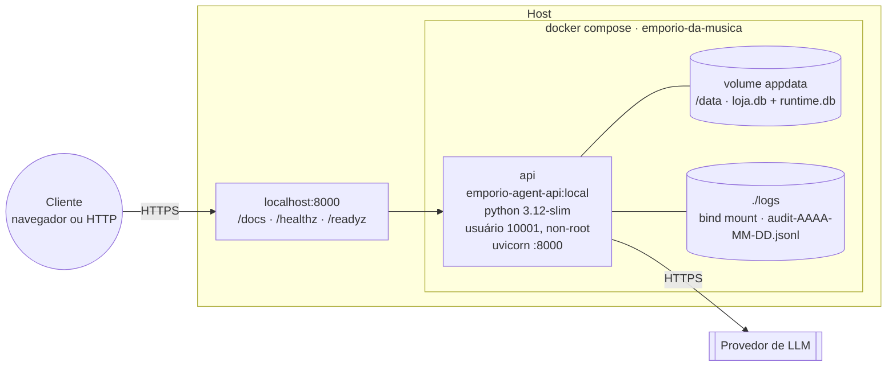

# Arquitetura — modelo C4

Diagramas do sistema de atendimento da Empório da Música. Todos em Mermaid (renderizam direto no
GitHub, sem servidor nem ferramenta externa) e versionados junto do código.

> O [`README.md`](../../README.md#architecture) traz uma versão em inglês do diagrama de
> contêineres para a audiência internacional; este documento é a referência completa em português.

**Chave** — o mesmo vocabulário nos cinco diagramas. A notação é secundária; o que precisa ser
idêntico entre eles é a abstração.

| Forma | Elemento C4 | Significado |
|---|---|---|
| retângulo com cantos arredondados | **Pessoa** | quem interage com o sistema |
| retângulo de borda simples | **Contêiner** | unidade executável ou de dados: aplicação, banco, volume |
| retângulo de borda dupla | **Sistema externo** | fora do nosso controle |
| cilindro | **Contêiner de dados** | banco, arquivo, volume |
| retângulo dentro de uma fronteira | **Componente** | parte de um contêiner, sem processo próprio |
| seta com rótulo | **Relação** | sempre unidirecional, na direção de quem inicia |

**Níveis entregues:** contexto (1), contêineres (2), componentes (3), mais dois diagramas de apoio
(implantação e dinâmico) — o conjunto que o C4 recomenda para um sistema deste tamanho.

> **Nível 4 (código) — fora de escopo, deliberadamente.** É o nível mais volátil: muda a cada commit
> e raramente responde a uma pergunta que o código não responda melhor no editor. O próprio C4
> recomenda desenhá-lo sob demanda e com escopo de **um** componente. Com mais tempo, o candidato
> seria `api/app/agent/runner.py` — o caminho crítico streaming → gate → persistência.

> **Sobre a notação.** O C4 é independente de notação: o valor está no vocabulário comum, não na
> forma. Os níveis 1–3 usam `flowchart` porque o layout automático do tipo `C4Context` do Mermaid
> cruza rótulos sobre as caixas — o que quebra a regra de que o diagrama precisa se sustentar sem
> narração. A chave acima cumpre o papel da notação.

---

## Nível 1 — Contexto

Quem usa, o que é o sistema e do que ele depende. Sem tecnologia e sem protocolo interno.

**O que este diagrama decide:** é **um** sistema, não uma constelação. O provedor de LLM é externo e
substituível por configuração; as transportadoras não têm integração por API — a loja repassa prazo e
rastreio que já estão no pedido e no manual.

---

## Nível 2 — Contêineres

O que executa, onde os dados vivem e quem fala com quem. Com tecnologia e protocolo.

**Por que o agente não é um contêiner separado.** O critério do C4 é: essas escolhas de tecnologia
executam no mesmo processo do sistema operacional? Sim — o agente é um grafo em memória dentro do
processo da API. Separá-lo criaria uma chamada de rede entre agente e banco a cada ferramenta, sem
ganho neste volume.

**Por que dois bancos.** A base operacional é reconstruída do zero a cada build e é somente leitura
para as ferramentas. O estado de execução é escrito a cada turno. Juntar os dois faria um
`docker compose down -v` apagar histórico e uma reconstrução de dados apagar sessões.

**Onde está o front-end.** É consumidor do contrato em `/docs` (OpenAPI). Este repositório entrega a
API; a interface é integrada por outro time e não altera a arquitetura.

---

## Nível 3 — Componentes

Dentro do contêiner da API. A ordem das setas é a ordem de execução.

**Nenhuma dessas cinco primeiras etapas é instrução no prompt.** Autenticar, limitar, triar, ancorar
o preço e auditar são código — e é por isso que valem como controle.

---

## Diagrama dinâmico — um turno de "quanto custa?"

O que acontece entre o clique e a resposta, incluindo o ponto exato onde o gate pode intervir.

**O detalhe que importa:** o gate roda **depois** dos tokens saírem. Se bloqueia, o cliente já recebeu
texto e precisa substituí-lo — por isso existe o evento `guard` com `acao: substituir_resposta`. A
alternativa (bufferizar tudo antes de emitir) anularia o streaming. Decisão registrada no ADR 0002.

---

## Implantação — Docker Compose

- **Sem TLS no container.** O compose é para desenvolvimento e demonstração. Em produção o TLS fica
  no proxy à frente (Caddy/nginx) — e o token exige TLS ponta a ponta, sempre.
- **Healthcheck** no `Dockerfile` e no `compose.yaml`: o serviço só é saudável quando `/healthz`
  responde.
- **Segredo**: `.env` fora do versionamento, injetado por `env_file`. A chave não entra na imagem nem
  no bundle do cliente.
- **Recursos**: sem réplica. O SQLite com WAL atende o volume esperado; escalar horizontalmente
  exigiria banco compartilhado — está nas limitações.
